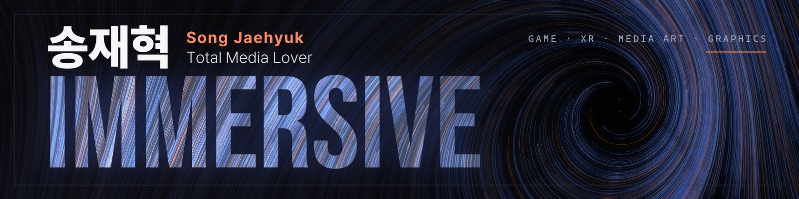
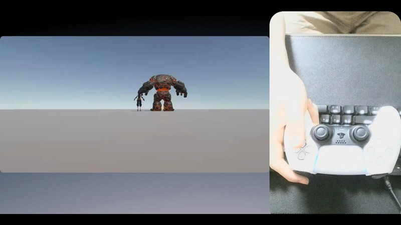
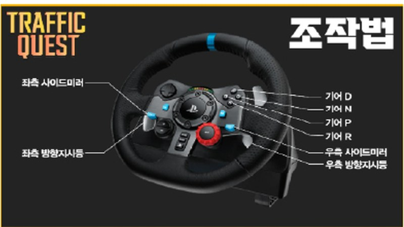
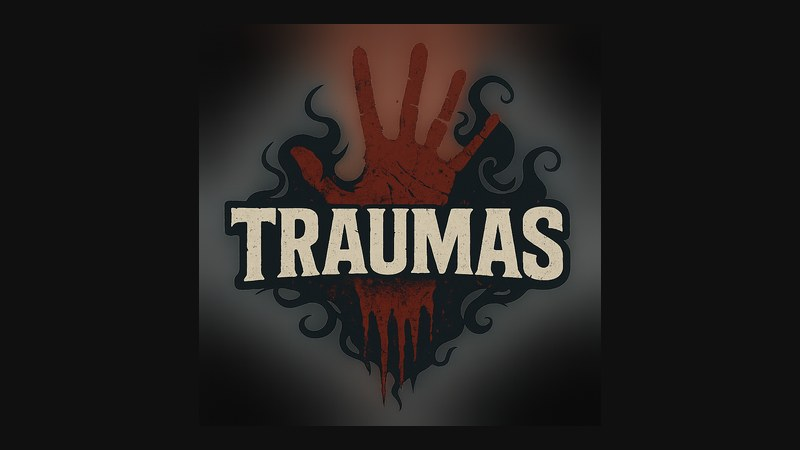
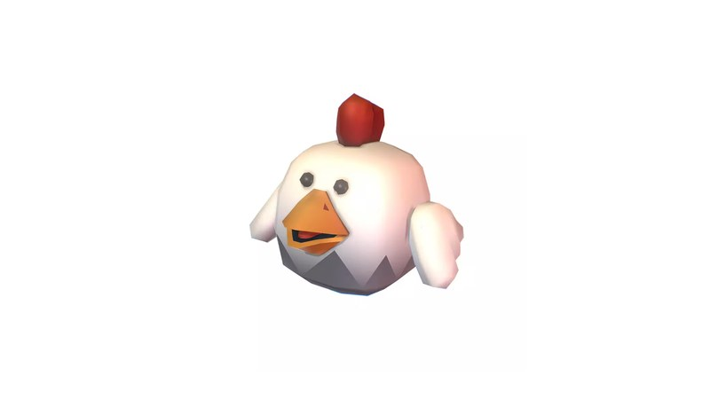
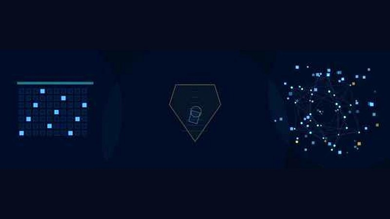
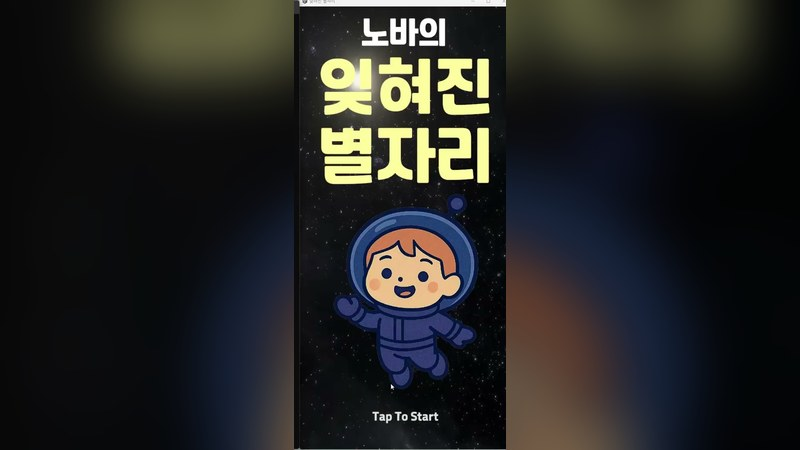
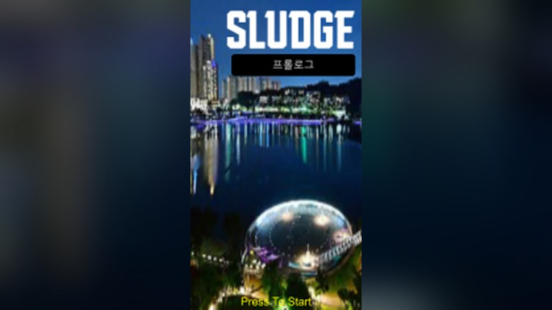
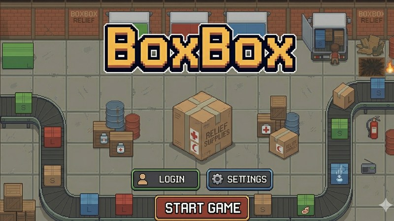

### 현실과 화면이 맞물리는 순간, 몰입을 설계하는 개발자

G29 휠, 스마트폰 AR, VR HMD, DualSense까지 — 입력 장치마다 다른 감각을 코드로 연결해 왔습니다.

**아주대학교** 디지털미디어학과 · 인공지능융합학과 복수전공 (2027.02 졸업 예정) &nbsp;|&nbsp; [📁 전체 포트폴리오 자료 (Google Drive)](https://drive.google.com/drive/folders/1qN_I8oP3dLOj-LXz7hJ7DIgn3Ujz-bwU)

 

## Featured Projects

<table>
<tr>
<td width="50%" valign="top">

**ProjectSoullike** · `Unity 6` `DualSense` · 진행 중

3인 팀 소울라이크 전투 데모. **팀장**으로 이슈·스프린트·통합 브랜치를 운영하며, 3단 콤보 판정, 락온, SphereCast 3인칭 카메라, 키보드·패드 통합 입력을 구현하고 있습니다. **🏆 2026 하계 모각소 장려상** 
[▶ 프로토타입 영상](https://drive.google.com/file/d/1MY2WfQkTSvCHqQLoKLFPLNJx8iV0jvy9/view)
</td>
<td width="50%" valign="top">

**Traffic Quest** · `Unity` `Logitech G29`

G29 휠·페달로 조작하는 운전 시뮬레이터. 팀원과 함께 입력 정규화와 WheelCollider 차량 제어를 만들고, UI 흐름과 페달 연동 엔진음·방향지시등 사운드를 맡았습니다. 
[📄 프로젝트 포스터](https://drive.google.com/file/d/1h9MDdBxNJWCKT6favhQOwuQrftxAiqkT/view)
</td>
</tr>
<tr>
<td width="50%" valign="top">

**Traumas VR** · `Unity` `XR Interaction Toolkit` `Oculus`

4개 스테이지 VR 공포게임. 영화관 스테이지의 소켓 퍼즐, 레버 씬 전환, NavMesh 좀비 추적을 구현하고 전체 스테이지를 하나의 빌드로 연결했습니다. 
[▶ 시연 영상](https://drive.google.com/file/d/1X247S16CohOtJ4z3uRoTRNnZgT2b79CI/view)
</td>
<td width="50%" valign="top">

**This is Our Home** · `Unity` `AR Foundation`

바닥 평면 위에 게임 공간을 세워 내려다보며 즐기는 AR 게임. 1인칭 AR 대신 이 시점을 제안했고, 캐릭터 애니메이션·오디오 매니저·아이템을 맡았습니다. 
[▶ 시연 영상](https://drive.google.com/file/d/1fkFn2PpRyHN7C3ggGESzZlO32mgwLhum/view)
</td>
</tr>
<tr>
<td width="50%" valign="top">

**A/JUNCTION: 공통좌표** · `Python` `Manim` · 개인 작업

중앙도서관 미디어월(5200×1664)을 위한 코드 기반 미디어아트. 13개 학문을 서로 다른 움직임으로 표현했습니다. **🏆 제1회 중앙도서관 미디어아트 영상 공모전 우수상** 
[▶ 작품 영상](https://drive.google.com/file/d/1Rsv2LDvIe85XjjAcHICKJDetsxXIYXUX/view)
</td>
<td width="50%" valign="top">

**잊혀진 별자리** · `Unity` `ML-Agents`

플레이 기록으로 난이도를 자동 조절하는 반응 게임 프로토타입. 성공률 70%를 목표로 하는 보상 설계와 자동 플레이 봇으로 Agent를 학습시켰습니다. 
[▶ 시연 영상](https://drive.google.com/file/d/1D_GWcWMXCCZPWjGZEGMwXTTCsHGzVDn1/view)
</td>
</tr>
<tr>
<td width="50%" valign="top">

**SLUDGE** · `Unity` `AR Foundation` `GPS`

광교호수공원 현장을 방문해 즐기는 환경 AR 콘텐츠. 기획·스토리부터 GPS 위치 판정, AR 평면 처리, 씬 흐름까지 개발 전반을 맡았습니다. 
[📄 프로젝트 포스터](https://drive.google.com/file/d/1Ug26IbHkNln5CfJF3lK8nF6aed4d1sc4/view)
</td>
<td width="50%" valign="top">

**BoxBox** · `Unity` `C#`

2인 로컬 협동 물류 게임. 플레이어 조작과 스태미나, 날씨 연동 장애물, 두 플레이어가 대형 박스를 함께 드는 협동 운반을 구현했습니다.
</td>
</tr>
</table>

 

## Tech

| | |
| --- | --- |
| **Engine** | Unity · C# · Input System · Animator · NavMesh &nbsp;/&nbsp; Unreal Engine (학습) |
| **Device · XR** | Logitech G29 SDK · DualSense · AR Foundation · XR Interaction Toolkit |
| **Language** | C# · C/C++ · Python |
| **More** | Unity ML-Agents · Manim · Git/GitHub |

## Activities & Awards

- 🎮 게임 개발 동아리 **TML 회장** — Unity·C/C++ 스터디, 팀 프로젝트, 데모데이 운영 (2026)
- 🏆 **모각소 3회 수상** — Unity ML-Agents (2025 하계 장려상) · Unreal Engine (2025 동계 우수상) · Unity·DualSense 게임 제작 (2026 하계 장려상)
- 🏃 러닝동아리 **ARC 부회장** — 정동아리 승격, 회원 150명 이상 성장 · 동아리 콘테스트 은상 (2026)
