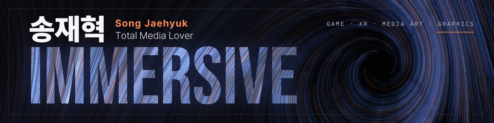
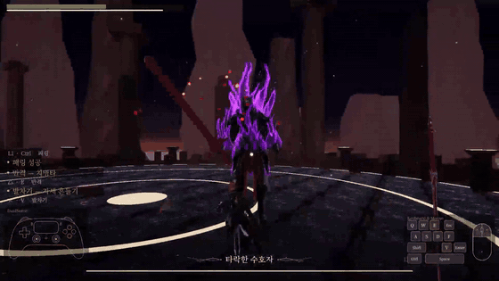
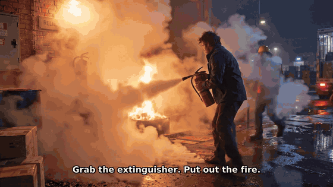
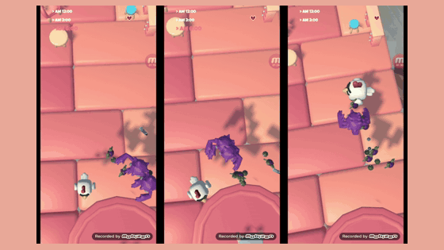
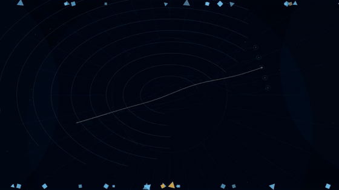
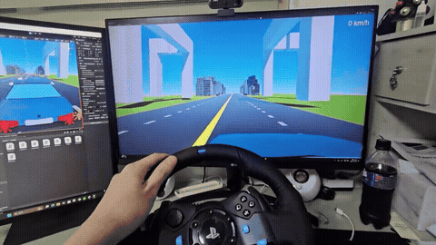
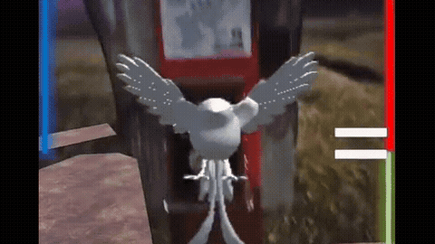
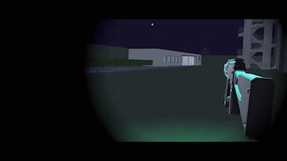
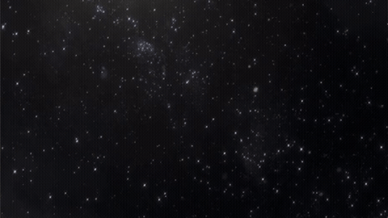
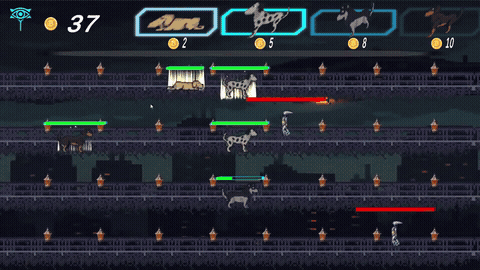

### 현실과 화면이 맞물리는 순간, 몰입을 설계하는 개발자

손끝에서 시작된 감각이 화면 너머의 세계로 이어지도록.

 

## Featured Projects

<table>
<tr>
<td width="50%" valign="top">

### 수호자의 무덤 Masterless
`Unity 6` `DualSense` `ML-Agents` · 3인 팀 · **팀장** · 2026.08 –

타락한 스승과 겨루는 3인칭 소울라이크 보스전. 난이도 메뉴 대신 보스가 플레이어에게 맞춰 갑니다.

- 패링·약점 반격·커맨드 공격 등 플레이어 전투와 애니메이션·VFX·타격감
- 동적 밸런싱: 판 안에서는 강화학습(PPO) 보스 디렉터, 판 사이에는 로지스틱 회귀 재도전 보정
- 블루투스 DualSense 진동, 일정·우선순위·통합과 PR 기반 협업 운영

**🏆 2026 하계 모각소 장려상** 
[▶ 플레이 트레일러](https://drive.google.com/file/d/13aL4C5A8cJc4hHiqXbdEsOoQpcKvt0mG/view) · [프로토타입 영상](https://drive.google.com/file/d/1MY2WfQkTSvCHqQLoKLFPLNJx8iV0jvy9/view) · [소개 저장소](https://github.com/WhySongSerious/Masterless-TombOfTheGuardian)
</td>
<td width="50%" valign="top">

### BoxBox
`Unity` `C#` · 4인 팀 · 미디어소프트웨어공학 · 2026.03 – 06

컨베이어에서 나오는 구호 물자 박스를 제한 시간 안에 맞는 트럭에 싣는 2D 탑다운 2인 로컬 협동 게임.

- 플레이어 조작: 이동·대시·스태미나, 박스 들기·내려놓기, 방향별 애니메이션
- 큰 박스 2인 협동 운반: 박스와 두 플레이어를 묶어 이동하고, 셋 중 하나라도 막히면 함께 정지
- 장애물 동작: 소화기로 꺼야 지나가는 불, 밟으면 느려지는 물웅덩이

Spring 기반 서버·리더보드, 컨베이어·트럭, 날씨별 장애물 생성은 팀원 담당 
[▶ 트레일러](https://www.youtube.com/watch?v=9fjjmCRjM68) (0:00–1:52) · [시연 영상](https://youtu.be/iQzGJ9OX12g) · [팀 저장소](https://github.com/12e0hw/MSE_BoxBox)
</td>
</tr>
<tr>
<td width="50%" valign="top">

### This is Our Home
`Unity` `AR Foundation` · 4인 팀 · 몰입형미디어프로그래밍 · 2025

방바닥 평면 위에 게임 공간을 세우고, 작은 영웅이 잠든 사람을 지키는 모바일 AR 디펜스 게임.

- 1인칭 AR 대신 바닥을 내려다보는 시점을 제안
- 캐릭터 이동 방향·트리거 애니메이션
- 씬별 오디오 매니저, 스프레이 아이템

[▶ 트레일러·플레이 영상](https://drive.google.com/file/d/1fkFn2PpRyHN7C3ggGESzZlO32mgwLhum/view) · [YouTube](https://www.youtube.com/watch?v=z-pV-MaLJg8) (0:00–1:40) · [팀 저장소](https://github.com/YoonByungSun/IMP_AR_Team1)
</td>
<td width="50%" valign="top">

### A/JUNCTION: 공통좌표
`Python` `Manim` · 개인 작업 · 2026.07 – 08

중앙도서관을 서로 다른 학문이 만나는 '공통좌표'로 해석한 코드 기반 미디어아트. 미디어월(5200×1664)에 상영했습니다.

- 13개 학문을 서로 다른 기하학적 형태와 움직임으로 표현
- 마지막에 각 학문의 요소가 아주대학교 심볼로 모이는 구성
- 기획·모션 설계부터 코드 구현·렌더링까지 혼자 진행

**🏆 제1회 중앙도서관 미디어아트 영상 공모전 우수상** 
[▶ 작품 영상](https://drive.google.com/file/d/1Rsv2LDvIe85XjjAcHICKJDetsxXIYXUX/view) · [저장소](https://github.com/WhySongSerious/AJunction_MediaArt)
</td>
</tr>
</table>

## More Projects

<table>
<tr>
<td width="50%" valign="top">

### Traffic Quest
`Unity` `Logitech G29` · 3인 팀 · 파란학기 · 2024

G29 휠·페달로 수원의 실제 도로를 달리며 교통법규를 익히는 운전 시뮬레이터.

- 신호 위반·과속·충돌 판정과 게임오버
- G29 입력과 WheelCollider 차량 제어(팀원과 공동)
- 페달 연동 엔진음, 메뉴·로딩 흐름

[▶ 소개 저장소·플레이 영상](https://github.com/WhySongSerious/TrafficQuest) · [포스터](https://drive.google.com/file/d/1h9MDdBxNJWCKT6favhQOwuQrftxAiqkT/view)
</td>
<td width="50%" valign="top">

### SLUDGE
`Unity` `AR Foundation` `GPS` · 메타버스프로그래밍 · 2024

광교호수공원을 실제로 걸으며 오염을 정화하는 스토리 AR 게임.

- 기획·스토리, GPS 도착 판정(700m)
- AR 지면 오염, 스탬프 번호 이미지 인식과 정령
- 5단계 스테이지와 슬라지군 보스전

[▶ 소개 저장소·현장 시연](https://github.com/WhySongSerious/SLUDGE-AR) · [포스터](https://drive.google.com/file/d/1Ug26IbHkNln5CfJF3lK8nF6aed4d1sc4/view)
</td>
</tr>
<tr>
<td width="50%" valign="top">

### Traumas VR
`Unity` `XR Interaction Toolkit` · 4인 팀 · 몰입형미디어프로그래밍 · 2025

네 개의 공포 스테이지를 이어 통과하는 VR 게임.

- 영화관 스테이지: XR 소켓 퍼즐, 레버 씬 전환, NavMesh 좀비 추적
- 네 스테이지를 하나의 빌드로 연결, 오프닝·엔딩

[▶ 소개 저장소·트레일러](https://github.com/WhySongSerious/TraumasVR) · [팀 저장소](https://github.com/YoonByungSun/IMP_VR_Team1)
</td>
<td width="50%" valign="top">

### 잊혀진 별자리
`Unity` `ML-Agents` `Gemini` · 2인 팀 · AI융합캡스톤디자인1 · 2025

플레이 기록으로 난이도를 맞추고 AI 코치 루나가 말을 걸어 주는 집중력 훈련 게임.

- 강화학습(PPO) 난이도 Agent, 성공률 70% 목표 보상, 학습용 자동 플레이 봇
- Flask + Gemini 피드백 서버와 루나 코멘트

[▶ 소개 저장소·시연 영상](https://github.com/WhySongSerious/ForgottenConstellation)
</td>
</tr>
<tr>
<td width="50%" valign="top">

### 멍멍전선 2077
`Unity 6` `2D` · 4인 팀 · 게임엔진프로그래밍 · 2025

낮엔 자원을 모으고 밤엔 강아지 부대로 로봇을 막는 디펜스.

- 5초 타이핑 소환과 강화
- 강아지 타입별 전투(원거리·범위·주기적 무적), 로봇 전진·방어선

[▶ 소개 저장소·플레이 영상](https://github.com/WhySongSerious/DogFrontline2077)
</td>
<td width="50%" valign="top">
</td>
</tr>
</table>

 

## Coursework

아주대학교 디지털미디어학과 · 인공지능융합학과에서 들은 주요 수업과, 각 수업에서 직접 구현해 본 내용입니다.

| 분야 | 수업 | 구현하며 익힌 것 |
| --- | --- | --- |
| **Real-time Rendering** | 컴퓨터그래픽스 | OpenGL·GLSL로 렌더링 파이프라인을 36단계로 쌓아 올림 — 뷰·투영 변환, 오빗 카메라, Phong 조명·감마 보정, 텍스처·범프 매핑, FBO 섀도 매핑 → PCF·소프트 섀도 |
| **Animation** | 애니메이션이론 | 스플라인 보간, BVH 모션 데이터 재생, 천(Cloth) 시뮬레이션 |
| **Image Processing** | 영상처리 | 미디언 필터링, 디컨볼루션, 영역 채우기 (OpenCV) |
| **XR** | Immersive Media Programming | AR 이미지·평면·얼굴 트래킹, 조명 추정·오클루전 / VR 로코모션, 컨트롤러 햅틱, 레버·소켓 퍼즐 상호작용 |
| **Game Engine** | 게임엔진프로그래밍 · 메타버스프로그래밍 | Unity 게임 제작과 튜토리얼 설계, 메타버스 콘텐츠의 몰입 요소 분석·기획 |
| **3D Modeling** | 3D그래픽디자인 | Maya 하드서피스·유기체 모델링, UV·렌더링, 얼굴 모델링 |
| **Software Engineering** | Media Software Engineering · 객체지향프로그래밍 | Java 객체지향 설계, Spring MVC·REST, 디자인 패턴, 마일스톤 기반 팀 개발 |
| **Systems** | 운영체제 · 컴퓨터시스템 | C 소켓 클라이언트·서버, 생산자-소비자·Readers-Writers 동기화 |
| **Algorithms** | 자료구조 · 알고리즘 | 그리디, 백트래킹, 분기 한정법, 최단 경로 |
| **Data & ML** | 데이터사이언스개론 · 기계학습기초 · 실전기계학습 | 게임 선택 로그를 LSTM 오토인코더 + K-means로 군집화해 플레이어 유형 분석, 회귀·분류 실습 |
| **Math** | 선형대수 · 이산수학 · 확률및통계 | 그래픽스·ML의 기반 수학 |

## Tech

| | |
| --- | --- |
| **Engine** | Unity · C# · Input System · Animator · NavMesh &nbsp;/&nbsp; Unreal Engine (학습) |
| **Device · XR** | Logitech G29 SDK · DualSense · AR Foundation · XR Interaction Toolkit |
| **Language** | C# · C/C++ · Python |
| **More** | Unity ML-Agents · Manim · Git/GitHub |

## Activities & Awards

- 💻 **코딩트레이너** — 컴퓨터프로그래밍및실습, 수강생 약 50명 코드 리뷰·질문 답변·채점 보조 (2026)
- 🎮 게임 개발 동아리 **TML 회장** — Unity·C/C++ 스터디, 팀 프로젝트, 데모데이 운영 (2026)
- 🏆 **모각소 3회 수상** — Unity ML-Agents (2025 하계 장려상) · Unreal Engine (2025 동계 우수상) · Unity·DualSense 게임 제작 (2026 하계 장려상)
- 🎓 **2025 경기 메타버스 캠퍼스 Unreal 과정 수료** — 경기콘텐츠진흥원 (2025.07–08)
- 📚 **모각소 C++ 알고리즘 스터디 수료** — 3인 팀 대표. 자료구조·알고리즘 강의 진도에 맞춰 백준 문제를 풀고 서로의 코드를 리뷰 (2024 동계, 10회)
- 🏃 러닝동아리 **ARC 부회장** — 정동아리 승격, 회원 150명 이상 성장 · 동아리 콘테스트 은상 (2025–2026)
